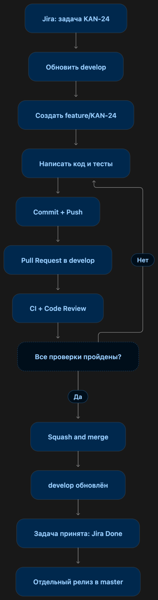

# Правила разработки и внесения изменений — Fit-Assistent

> **Для участников команды и новых разработчиков.** Репозиторий: [Borivichki-community/Fit-Assistent](https://github.com/Borivichki-community/Fit-Assistent).  
> Основной принцип: **одна задача Jira → отдельная рабочая ветка → Pull Request → ревью и проверки → `develop` → релиз в `master`**.  
> Это согласованный процесс команды. Архитектурные и технические требования описаны отдельно в [`AGENTS.md`](AGENTS.md).

## 1. Назначение веток

| Ветка | Назначение | Правила |
|---|---|---|
| **`master`** | **Релизная, наиболее стабильная версия** проекта. Содержит только согласованные и проверенные изменения. | Не коммитить и не пушить напрямую. **Только PR `develop → master`** для релиза; **без `cherry-pick`**. |
| **`develop`** | Общая ветка интеграции новых функций, исправлений и тестов. Может содержать изменения, которые ещё не вошли в релиз. | Не коммитить напрямую. Изменения принимаются через PR из рабочих веток. |
| `feature/KAN-XX-кратко` | Одна новая функция или задача из Jira. | Создаётся **от актуальной `develop`**, после принятия PR может быть удалена. |
| `fix/KAN-XX-кратко` | Исправление ошибки. | Создаётся от `develop`; также вливается в `develop` через PR. |

Примеры: `feature/KAN-24-gradle-backend`, `fix/KAN-28-profile-validation`. `KAN-XX` — **реальный ключ** задачи Jira (не путать с внутренним номером `T-005`). Не смешиваем несколько независимых задач в одной ветке. Срочное исправление для релиза также сначала проходит через `develop`.

## 2. Схема жизненного цикла задачи

<p align="center">
  
</p>

```text
master:   ●─────────────────────────────────────●  ← релиз после PR из develop
           \                                     /
develop:    ●──────●────────●──────────────────●   ← общая разработка
             \    /          \                /
feature:      ●──●            ●──●───────────┘    ← отдельные задачи Jira
                 PR + squash       PR + squash
```

**Работа с Jira:** `To Do` — запланирована; `Ready` — можно брать; `In Progress` — разработка и локальные тесты; `In Review` — открыт PR и проводится проверка; `Done` — PR в `develop` принят, критерии задачи выполнены. **`Done` не равно «выпущено в `master`»**: релиз — отдельное действие. Если ревью выявило ошибки, исправляем их в той же рабочей ветке и обновляем PR.

## 3. Начало работы и обновление проекта

Перед изменениями изучите [`AGENTS.md`](AGENTS.md), [`STATE.md`](STATE.md) и документы в [`docs/architecture/`](docs/architecture/). Проверяйте привязку задачи в Jira, зависимости и критерии готовности.

```bash
# В папке репозитория
git status
git branch --show-current
git remote -v
git fetch origin

# При чистой рабочей папке — обновить основу разработки
git switch develop
git pull --ff-only origin develop

# Начать работу по своей Jira-задаче
git switch -c feature/KAN-24-gradle-backend
```

`git fetch` загружает сведения о новых коммитах и ветках, **не меняя рабочие файлы**. `git pull --ff-only` обновляет текущую ветку без неожиданного merge-коммита. Перед переключением веток незавершённые изменения нужно сохранить коммитом или временно убрать через `git stash` (и затем вернуть через `git stash pop`).

## 4. Коммиты и публикация ветки

Используем понятный формат сообщений **`type(KAN-XX): краткое действие`** на английском, в повелительной/описательной форме. Один коммит — одно логически законченное изменение.

| Тип | Когда использовать | Пример |
|---|---|---|
| `feat` | Новая функциональность | `feat(KAN-28): add profile service contract` |
| `fix` | Исправление дефекта | `fix(KAN-28): validate profile input` |
| `test` | Тесты | `test(KAN-24): cover backend configuration` |
| `build` / `ci` | Сборка / GitHub Actions | `build(KAN-24): configure Gradle modules` |
| `docs` / `refactor` / `chore` | Документация / рефакторинг / обслуживание | `docs(KAN-24): document local setup` |

```bash
git status
git diff
git add путь/к/нужному/файлу    # заменить на реальный путь
git diff --cached                 # проверить состав коммита
git commit -m "build(KAN-24): configure Gradle modules"
git push -u origin feature/KAN-24-gradle-backend
```

**Не добавлять** токены, пароли, `.env`, ключи, бинарные результаты сборки и личные данные. Не использовать `git add .` вслепую. Никогда не применять `git push --force` к `master`, `develop` или чужой общей ветке. Если ветка уже используется другим участником, не переписывать историю без согласования.

## 5. Pull Request (PR) и ревью

Для рабочих задач PR открывается **из `feature/...` или `fix/...` в `develop`**. Пример заголовка: **`KAN-24 [T-005] Configure backend Gradle modules`**. В описании должны быть: ссылка/ключ Jira, что изменено, как проверено, что осталось или какие есть риски. Назначаем **другого разработчика** ревьюером; автор не принимает собственный код без проверки.

Перед слиянием:

- [ ] Код соответствует [`AGENTS.md`](AGENTS.md) и архитектурным документам; задача Jira и зависимости проверены.
- [ ] Нет посторонних файлов, секретов и незапланированных изменений.
- [ ] Добавлены или обновлены необходимые тесты; локальные проверки выполнены.
- [ ] GitHub Actions **фактически** прошли нужные проверки; нет конфликтов с `develop`.
- [ ] Замечания ревью устранены, получено одобрение второго разработчика.

Для feature/fix PR используем **Squash and merge**: несколько промежуточных коммитов задачи превращаются в один понятный коммит в `develop`. Если после открытия PR в `develop` появились изменения, обновите рабочую ветку из `develop`, решите конфликты локально, повторите тесты и `push`. Самостоятельно закрывать задачу в Jira до принятия изменений не следует.

> **Особенность текущего CI:** `build.yml` проверяет KMP/Android, Buf и backend, но некоторые шаги условно пропускаются, если исходников пока нет; Trivy пока не делает сборку красной при находках. `jules-qa.yml` запускает интеграцию с Jules, однако статус workflow `success` **сам по себе не гарантирует**, что Jules выполнил QA или создал тесты. Смотрите логи и реальные результаты проверки.

## 6. Релиз: строго `develop → master`

**`master` — единственная релизная и наиболее стабильная ветка.** Выпуск делается **только целым согласованным состоянием `develop`**, без `cherry-pick` отдельных коммитов и без прямых пушей в `master`:

1. Убедиться, что нужные задачи приняты в `develop`, сборки и тесты проходят, критических известных ошибок нет.
2. Открыть **PR `develop → master`** с названием вида `release: v0.1.0` и перечнем вошедших задач KAN.
3. Выполнить итоговую проверку и взаимное ревью. Для релизного PR использовать **Create a merge commit**, а не Squash: так история `develop` сохраняет связь с `master` и следующие релизы сравниваются корректно.
4. После слияния при необходимости поставить релизный Git-тег (`v0.1.0`), опубликовать Release и проверить результат CI/CD.

**Важно:** имеющийся `deploy.yml` пока содержит *заглушки* сборки/развёртывания и старое упоминание `cherry-pick`; этот текст нужно исправить отдельно. Факт слияния в `master` **не означает автоматического успешного развёртывания приложения**. В текущей конфигурации CD срабатывает на push в `master` только при изменении заданных backend/infrastructure-путей или при ручном запуске.

## 7. Если что-то пошло не так

- **Проверить, что скачалось:** `git status`, `git branch -a`, `git log --oneline --graph --decorate -10`.
- **Конфликт с `develop`:** в рабочей ветке выполнить `git fetch origin`, затем `git merge origin/develop`; исправить конфликтующие файлы, проверить изменения, завершить слияние коммитом и отправить `git push`. При сомнениях — попросить ревью, не удалять чужие правки.
- **Не та ветка:** прежде чем коммитить, выполнить `git branch --show-current`.
- **Красный CI:** открыть конкретный failed job в GitHub Actions, исправить причину в *той же* рабочей ветке и повторно проверить PR.
- **Случайные незакоммиченные изменения:** не применять `reset --hard` без понимания последствий; сначала посмотреть `git status`/`git diff`.

**Краткая памятка:** `fetch` — узнать новое; `pull --ff-only` — безопасно обновить свою ветку; `commit` — сохранить локально; `push` — отправить на GitHub; **PR** — предложить проверенное изменение; **merge** — включить принятое изменение в целевую ветку.
